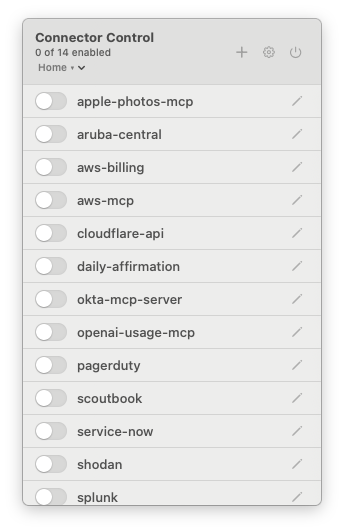
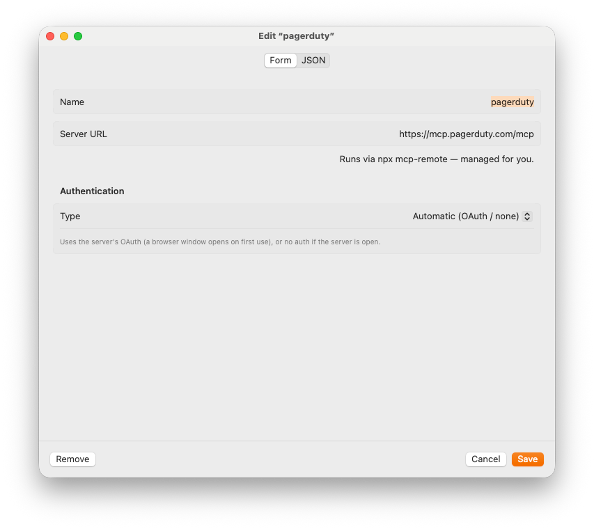
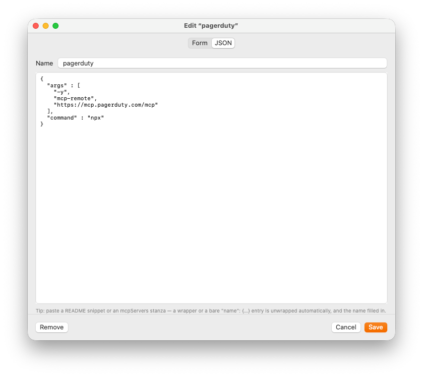
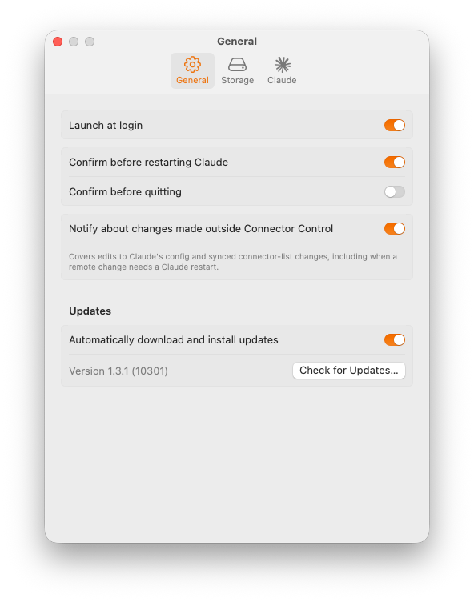
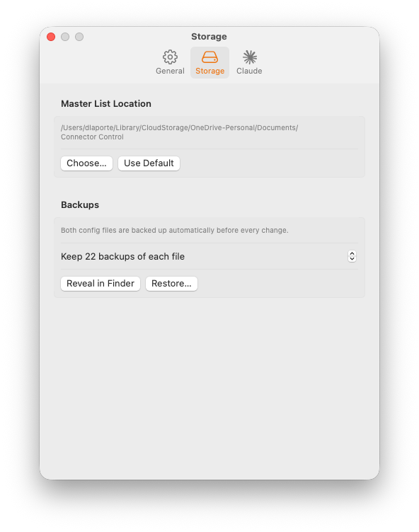
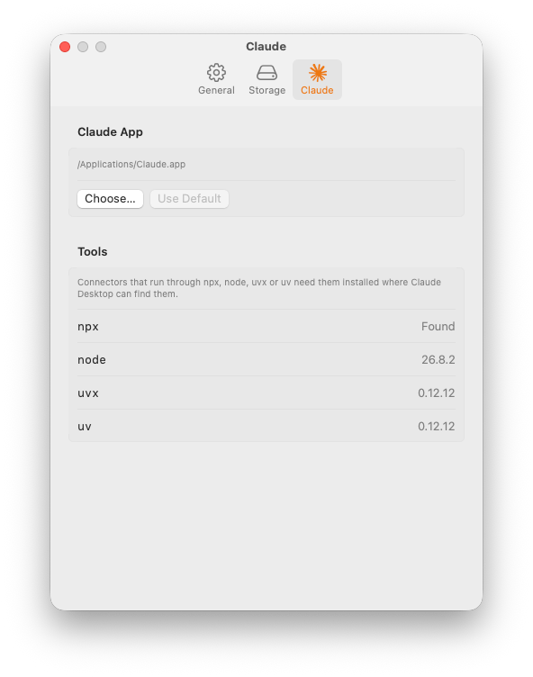

# Connector Control

Native menu bar (macOS) and system tray (Windows) apps for managing the
custom MCP connectors in Claude Desktop's configuration — with automatic
backups of every change they make.

Claude Desktop reads its MCP servers from claude_desktop_config.json
(`~/Library/Application Support/Claude/` on a Mac, `%APPDATA%\Claude\` on
Windows), a file you otherwise maintain by hand and that Claude itself has
been known to overwrite or wipe
([#32345](https://github.com/anthropics/claude-code/issues/32345),
[#56296](https://github.com/anthropics/claude-code/issues/56296),
[#37286](https://github.com/anthropics/claude-code/issues/37286)). Connector
Control keeps its own **master list** as the source of truth, treats Claude's
config as generated output, and backs up each file it manages — Claude's
config, the master list and collections.json — before writing to it, so a
wiped or mangled config is always one click from restored.

<p align="center">
  
</p>

<p align="center"><sub>Pending: equivalent Windows tray-flyout screenshots.</sub></p>

## Features

- **One-click enable/disable** — toggle any connector from the menu bar or
  tray; changes apply to Claude's config immediately, and a **Restart
  Required** button appears until Claude is running the new config (derived
  from Claude's actual process launch time, so it clears no matter how Claude
  restarts).
- **Full editor** — form view for the common cases (remote `mcp-remote`
  servers get a simple Name + URL form; local servers get command/args/env
  editors with secret masking, the arguments numbered from 1 as messages count
  them), plus a raw JSON view with live validation and
  paste-a-README-snippet support. The two views stay in sync, and switching
  never silently loses fields the form can't represent.
- **Self-healing** — the app watches Claude's config; if connectors vanish
  from it (Claude update, cloud sync, crash), it writes them back from the
  master list on its own and raises **Restart Required**, and a notification
  says so even when the app's window is closed.
- **Automatic backups** — timestamped copies of Claude's config, the master
  list and collections.json, each taken before that file is written
  (configurable retention, plus a permanent first-run snapshot), with in-app
  restore.
- **Syncable** — point the master list at a folder synced by git, iCloud, or
  Dropbox and share one connector catalog across machines; backups always
  stay machine-local so they never pollute the synced folder.
- **Missing-tool warnings** — a connector that starts through npx, node,
  uvx or uv shows a caution glyph when that tool isn't installed where
  Claude Desktop can find it; the editor and Settings ▸ Claude ▸ Tools say
  what to install, with a download link and the brew or winget command.
- **[Claude integration and command line](#claude-integration-and-command-line)**
  — once you turn it on, Claude can list, switch and edit your connectors,
  and asks you before it adds, edits or deletes a connector; a
  `connector-control` command-line tool does the same for you, your scripts
  and MDM.
- **Careful with secrets** — connector env vars can hold API tokens, so the
  master list and all backups are written owner-only (mode 600 on macOS, an
  owner-only ACL on Windows).

The editor's two views of the same connector:

<table>
  <tr>
    <td align="center"><br><sub>Form view</sub></td>
    <td align="center"><br><sub>JSON view</sub></td>
  </tr>
</table>

### Collections

Collections are full, independent connector snapshots — each has its own
complete list of connectors and enabled flags. The popover (Mac) or flyout
(Windows) runs the active one. A chip in its header — `<collection name> ▾`
— shows which collection that is and opens a menu of every collection, a
check on the active one, then **Manage Collections**. Choosing a collection
switches to it, which applies immediately, same as any other change, and
raises **Restart Required** just like a toggle would. The switches below the
chip turn the active collection's connectors on and off. That is all the
popover or flyout does: adding, editing, copying and sharing connectors
happen in the Collections window.

<p align="center">
  
</p>

A collection is one of three kinds.

**Local** collections are the ordinary kind, and everything in them is
editable. Every profile from an earlier version is now a local collection
with the same name and the same connectors. The last local collection can't
be deleted, so there is always somewhere to add a connector.

**Subscribed** collections are read-only mirrors of a collection document
somebody else publishes. You fill in the values the author left for you and
switch connectors on and off; nothing else can be edited, and nothing can be
added — the Collections window's **+** above the connector list is dimmed
with the tooltip "Additions go in a local collection." A chain glyph follows
the collection's name on the chip and in the Collections window's sidebar,
with the source file's path in its tooltip, and an amber dot joins it while
an update is waiting to be reviewed. In the chip's menu on a Mac the chain
is the row's icon and a waiting update reads "· update available" after the
name, because a macOS menu row draws one title and one image; the Windows
menu draws the chain and the dot. Every row of a subscribed collection
carries a lock.

**Published** collections are local collections that also write their
document to a folder whenever their content changes. They carry no glyph on
the chip or in the sidebar; the Collections window's header marks them
**Published**. Where the document goes is a fact about one machine, so only
the machine that publishes it says so: the Collections window's ⋯ menu offers
Show Published File, and the editor has a line at the top: "Published to
<folder> — saving updates the file your team reads. Secrets stay here."

**Manage Collections** opens the Collections window. When the active
collection has no connectors, the popover or flyout says "No connectors in
“<collection>”." with a **Manage Collections** button beneath it, which
opens the window on that collection. Every control in it
sits on the thing it acts on. What this README calls a sheet — Import,
Copy, Publish, Export, Review — opens as a dialog on Windows. Escape cancels
any of these, and the connector editor, as its **Cancel** button does.

- **The sidebar** lists the collections under the heading **Collections**.
  Its **+** (tooltip "Add Collection") offers **New Collection**, which
  asks for a name and makes an empty local collection, leaving Claude
  running the active one; fill it with the list's **+**, then make it active
  once it holds what you want. Next come **Import**, "Adds copies you own",
  and **Subscribe**, "Stays in sync, read-only" (see Sharing a collection
  with a team).
  Selecting a collection only shows it; double-click it, press Return, or
  choose **Make Active** from its context menu, to switch to it.
  Double-clicking the collection that is already active does nothing. Renaming or deleting a
  collection other than the active one changes nothing Claude runs, so it
  leaves Claude's config alone and raises no **Restart Required**. Deleting
  the active collection makes the first local collection by name that has
  connectors active, or, when none has, the first remaining collection by
  name; the confirmation names it.
- **The header** carries the selected collection's name, its pills — a green
  **Active** on the collection Claude is running, then **Published** or
  **Subscribed**, never both — and a **⋯** (tooltip "More") holding
  everything done to the collection itself. Under the name, the header
  counts the collection's connectors — "5 connectors". On a subscribed
  collection whose source couldn't be read, the reason follows the count: "5
  connectors · data-team.json couldn’t be read: …". The menu lists only what
  applies: **Make Active** first, on a collection that is not active;
  **Rename**; **Duplicate**, or **Make Local Copy** on a subscribed
  collection; **Start Publishing**, or once it publishes **Publishing
  Settings** and **Stop Publishing**, with **Show Published File** on the
  machine that writes the file; on a subscribed collection **Refresh** and
  **Show Source File** once its file has been found, and **Stop Syncing**,
  which asks first; **Export All**, dimmed on a subscribed collection; and
  **Delete**, which asks first and says what goes with the collection: its
  connectors ("Its 3 connectors are deleted with it."), but not their copies
  in other collections, nor a subscribed collection's source file; the
  collection that becomes active, when it is the active one; and, when it
  held connectors, that a copy remains in Backups. Duplicate copies a local
  collection into a new local one exactly as it stands, each connector's
  switch included; it is your own copy, so nothing new is marked as
  imported, and a connector the source held as an imported copy keeps its
  "Imported from" line.
  Make Local Copy copies a subscribed collection into a new local one, every
  connector switched off and marked with where it came from. Neither makes
  the copy active.
- **The connector list** has its **+** under the header's ⋯, beside the
  count (tooltip "Add Connector"). It opens the editor on a new connector in
  this collection. Each row has a tick — a lock on a subscribed collection —
  then the connector's name, a caution glyph when something needs your
  attention, and what the connector runs. Click a row anywhere but its tick
  to open its editor (read-only on a subscribed collection); a click on or
  near the tick ticks it. From the keyboard, the arrow keys move between
  rows, Return opens the editor and Space ticks. Names line up in a column
  as wide as the longest of them, up to a cap past which a long name is cut.
  There is no switch here and no right-click menu: whether a connector is on
  is the popover's or flyout's business, so to switch a connector in another
  collection, make that collection active first.
- **The selection bar** along the bottom is empty while nothing is ticked.
  Tick rows and it reads "2 selected", with **Copy to**, **Export** and,
  apart at the far end, **Delete**. The rows of a subscribed collection
  can't be ticked.

The column after the name says what the connector runs: a remote connector's
host (with its scheme, `https://mcp.example.com`, for one Claude reaches by
URL alone rather than through mcp-remote), or a local one's program with its
paths, URLs and package names — `npx …/server-filesystem ~/Documents`. It is
built to leave secrets out. It shows the program's name, a URL as its
scheme, host and port, a file path with your home folder shortened to `~`,
and a package's name. It leaves out whatever follows a flag named like a
secret (anything with token, key, secret, pass, pwd, pw, auth, credential or
bearer in it), any `KEY=value` word, a URL's user name and password and its
query string, long random-looking strings, and everything it does not
recognise, flags included. It is a best-effort mask, not a guarantee: a
secret shaped like a path or a package name, or one following a flag that is
not named like a secret, still shows, as does one written into a real
hostname, or a hyphenated word in the place where npx or uvx names the
server it runs. Check the column before you share a screenshot of the
window.

**Copy to** lists every other collection — a subscribed one is listed but
dimmed and marked "read-only", since its connectors are the author's — then
**New Collection**, which asks for a name and makes an empty local
collection to take the copies. Copies arrive switched off and record where
they came from. When the destination already holds a name you ticked, the
Copy sheet asks about each clash: **Replace**, **Keep both**, which lands the
copy as `<name> 2` and is the default, or **Skip**; the rest are listed as
"new · arrives off". Replacing a connector in the active collection applies
at once. **Export** opens the
Export sheet on the ticked rows. **Delete** asks first — "Delete
“<name>”?", or "Delete 3 connectors?" — adding "A copy remains in Backups.";
deleting from the active collection applies at once.

A connector that another local collection holds an identical copy of opens
in the editor with a checkbox, off by default: "Also apply this change to
<collection>, which has an identical <connector>". Tick it and saving makes
the same change in those collections too; each copy keeps its own switch.

<p align="center">
  
</p>

The master list file (mcps.json) is v2 (collection-aware); an older v1 file,
from a build before 1.1, is treated as any unreadable one is (see How it
works): kept aside and replaced by the newest backup that can be read, or
rebuilt from Claude's current config when none can, as is usual for a file
that old. Beside it, a
collections.json records which collection is which kind, what each one
still needs, and each published collection's settings, including the text
of every path you marked. **If you sync mcps.json across machines, every
machine must run 1.1 or later** — an older app can't parse the v2 file and
will treat it as corrupt.

### Sharing a collection with a team

A **collection document** is a single JSON file describing a collection's
connectors. Publishing writes that file to a folder and keeps it current;
subscribing follows it. No network access is involved: git, OneDrive, Google
Drive, Dropbox or a file you hand over carry the document, exactly as they
carry the master list today.

#### Publishing

Select a local collection in the Collections window and choose **Start
Publishing** from its **⋯**. Point it at a folder in a repository or a synced drive — the master list's
own folder and the backups folder are refused — and the app writes
`<collection-name>.json` there, the name lowercased with every run of other
characters collapsed to a hyphen. The file name and the document's identity
are fixed the first time you publish and never re-derived, so renaming the
collection later does not rename the file.

The sheet decides what leaves the machine:

- **Environment values · stripped unless shared** lists every variable of
  every connector with a **share value** tick. Unticked, which is the
  default, the row takes your hint: only the variable's name and that hint
  travel, and each subscriber supplies the value. Ticked, the row shows the
  value that will travel, and the value goes into the document.
- **Machine-specific paths · found in arguments** lists every argument that
  looks like a path on this machine, each with a tick that marks it; a
  marked row asks for a placeholder name and a hint. Unmarked, which is the
  default unless this machine already keeps that path back, it travels as
  written. Marked, it travels as a placeholder every subscriber fills in for
  themselves.
- **Document preview** is the document itself, exactly as it will be
  written. An argument or shared value that looks like a credential is
  listed under the preview, each line naming the connector it came from,
  and so are a header or a URL query or fragment parameter named like a
  secret or holding one, a URL parameter whose name is itself a token, a URL
  path segment that looks like a key, and a URL with a user name or password
  in it. Each line says how the value is held: one that only refers to a
  credential kept elsewhere, such as `Bearer ${API_TOKEN}`,
  `Bearer $API_TOKEN` (without braces, only a name in capitals, as a shell
  writes its variables) or a placeholder, "refers to a credential", and a
  URL user with no password "names a user". A connector whose value then
  holds the credential itself waits for review again, and so does one given
  a new path segment or bare parameter that looks like a key: each position
  is a line of its own.
  Nothing is ever edited on your behalf; the preview is there so you see
  every byte before it leaves.

Once the collection publishes, the same menu's **Publishing Settings**
changes what is shared or re-marks a path: the sheet reopens on the folder and every tick the collection
publishes with, and pressing Publish there updates what is shared and
rewrites the document.

The bearer token, custom header value or OAuth client secret set in a
remote connector's Authentication fields always becomes a placeholder,
whatever you tick. A header typed straight into the arguments travels as
written, so check the preview for one; the warnings under it read it as a
header, with or without a space after the colon (`Authorization:Bearer …`).
Enabled flags never travel, so turning a connector on or off never rewrites
the document.

`${COLLECTION_DIR}` is the other way to keep a path out of a document. Write
it into a local server's command, arguments or environment values and each
subscriber's app expands it to the folder their copy of the document sits
in — so a team that keeps the document beside the server in one repository
shares one entry:

    "command": "node",
    "args": ["${COLLECTION_DIR}/ledger/dist/index.js"]

On the machine that publishes the collection, `${COLLECTION_DIR}` stands for
the publish folder, so a tool you keep beside the document runs from there
from the moment publishing starts. The published document still carries the
token as written, and each subscriber resolves it against their own copy of
the folder. In a local collection this machine does not publish — never
published, stopped, or published from your other machine — the token has no
folder: Claude gets it unexpanded, and the connector's row says
"${COLLECTION_DIR} has no folder until this collection is published from
this Mac." ("this PC" on Windows). Stop Publishing leaves the token in place
rather than writing the folder into those connectors. A connector that moves
from a document into a local collection — imported as a copy, copied to a
local collection, or kept by Make Local Copy or Stop Syncing — gets the
folder written in place of the token, once, since a local collection has no
document to resolve it against later.

The document is rewritten whenever what the collection runs changes, by the
machine that published it. **That machine has to be running for a change to
reach the team**: an edit made on your other machine travels through the
master list and is published the next time the publishing machine sees it. A
write that fails puts "Couldn’t publish …" on the banner with **Choose
Folder**, and in the popover or flyout **Stop Publishing** beside it (in the
window, Stop Publishing is in the **⋯**). The Publish sheet stays open on
a failure, and pressing Publish there, or in the sheet opened again later,
retries at once; otherwise the next change retries the write. The banner
goes if the collection stops publishing, or is deleted, on your other
machine.

An automatic publish never sends a connector you haven't reviewed in the
Publish sheet, or a new credential in one you have. A connector added to a
published collection, copied or imported into it, or added on your other
machine, and a connector edited so that it now holds something that looks
like a credential (in an argument, a shared value, a header or its URL),
stop the automatic publish: the banner names the connector and offers
Publishing Settings, and the document in the folder stays as it was until
you press Publish there. Publish reviews what the sheet showed you: a
connector that arrives while the sheet is open waits until you open it
again. Other edits, renames and deletions publish on their own as before.

Export writes the same document once, wherever you choose, with the same
preview and warnings. The **⋯** menu's **Export All** writes the whole
selected collection; the selection bar's **Export** writes only the rows you
tick. A subscribed collection is the author's document already, so Export
All is dimmed on one and its rows can't be ticked.

#### Subscribing

**Subscribe**, under the sidebar's **+**, picks a document and opens the
Import sheet on **Keep as its own collection, in sync with this file**;
**Import** opens the same sheet on the other mode. Either way the sheet names the document and lists its
connectors before anything happens; a file it cannot read shows why
("<file> couldn’t be read: …"), with no Import button. A subscribed
collection arrives with every connector switched off and does not become
the active one.

What is the author's: names, commands, arguments, URLs and auth. They open
locked in the editor under a grey line reading "Synced from <name> ·
read-only", with a **What can I change?** link that spells out the rule.
What is yours: the values the document asks this machine for, and which
connectors are on. If the author changes or deletes a connector while its
editor is open, **Save** refuses — "“<name>” changed outside this editor."
or "“<name>” was deleted outside this editor." — rather than write the old
version back; reopen the editor to fill in your values again.

When the author changes the file the collection says so — "Data team changed
at its source: adds jira; deletes confluence." — with **Review & Apply**.
The review sheet groups what would land under **Added**, **Deleted** and
**Changed**, with the JSON either side of every change, and nothing lands
until you press **Apply**. Added connectors arrive switched off, and your
filled values follow their placeholder even if the author moved it to
another argument. If the collection is active, applying rewrites Claude's
config and raises **Restart Required**. **Refresh** re-reads the file on
demand. A half-written file, or one a sync client has not fetched yet, is
retried quietly before anything is reported.

Another machine picks the collection up from the master list, but where the
document sits is a per-machine fact. If it lies inside the master-list
folder the app finds it by itself; otherwise the collection shows "<name>’s
file isn’t on this Mac yet." — "this PC" on Windows — with
**Locate <file>**.

To take a subscribed collection somewhere you can edit it, choose **Make
Local Copy** from its **⋯**: it copies the whole collection into a new local
one, every connector switched off. **Stop Syncing** turns the collection
itself into an ordinary local one, keeping every connector, every value you
filled in and every switch; it asks first, and says as much. Deleting a
subscribed collection never touches the source file.

#### Importing as copies

The Import sheet's other mode, **Add to a collection**, copies the
document's connectors into a local collection of your choosing and keeps no
link to the file afterwards. It starts on the collection selected in the
Collections window when that one is local, otherwise on the active collection
when that one is, and otherwise on the first local collection by name. The last choice, **New Collection**, asks for a name; an empty
one is refused with "Name must not be empty." and the picker goes back to
the collection it was on. The copies then go into a new, empty local
collection, which does not become active. It is made only when Import can
land: a document that can no longer be read by then makes nothing, and the
sheet says why.
Each connector is listed as "new · arrives
off", "already present · skipped", or "skipped: <reason>". A name the
collection already holds starts unticked, as "already present · skipped";
tick it to choose **Replace**, the default, which "keeps your filled values",
**Keep both**, which lands the new one as `<name> 2`, or **Skip**. Every
copy arrives switched off, and its editor carries an italic line: "Imported
from “<name>” on <date>. Edits stay here."

#### Placeholders

Wherever the author stripped a value, the document carries a
`${CC_NEEDS:<name>}` marker in its place, and the connector waits for yours.
The row
shows a caution, the editor marks the field "needs your value" or "needs
your path", and the author's hint sits with it. Filled values are yours:
they live in your master list, they never go into a document, and they
survive every update from the source. A subscribed collection that uses
`${COLLECTION_DIR}` but has not found its file yet says "Locate the
collection file to resolve paths." on the rows that need it.

#### Trust

Every connector in a document is a command Claude runs. Anyone with write
access to the shared folder can change what Claude runs on every subscriber,
once those subscribers apply the change — the review step is the control.
A connector that runs a program kept in the shared folder through
`${COLLECTION_DIR}` is the exception: a change to that program reaches every
subscriber the next time Claude starts it, with nothing to review, because
the review covers the document and not the files it points at. Treat write
access to a published collection's folder as you would treat access to the
machines that follow it, including the one that publishes it.

#### Worth knowing

- **Stop Publishing** — and deleting a published collection — asks "Also
  delete <file> from the folder?", and keeping it is the default: Return
  and Escape both keep it, and deleting it takes a click on **Delete**. Stop
  Publishing from the failed-write banner, or while the last write is
  failing, keeps the file without asking. Once the file is kept, publishing
  that collection into the same folder again is refused with "<file>
  already exists there and belongs to a different collection.": the
  leftover file carries the identity the collection had before, and the app
  never writes over a document it cannot vouch for. Delete the file from the
  folder, then publish again.
- A path you mark in the Publish sheet is remembered together with the text it
  had, so it stays a placeholder when you add, delete or reorder arguments
  around it, correct it in place in the editor's form, or rename the
  connector. If it changes somewhere the app cannot follow — the JSON view,
  a hand edit, or an older version of the app on any machine — and the app
  can no longer tell which argument it is, the app stops publishing that
  collection rather than send the path as written. The banner gives the
  reason, "A path marked in “<connector>” has moved. Open Publishing
  Settings to mark it again." Publishing stops the same way, each with a banner of its own,
  when the document would carry a path this machine keeps back, or this
  machine's publish folder, in some other connector. However it stops, the
  document already in the folder is left exactly as it was, and subscribers
  receive none of that collection's other changes until the entry is
  answered.
- Reopen **Publishing Settings** and the sheet lists every mark it could not place,
  and every path this machine keeps back that turns up elsewhere in the
  document, each with its connector and the field it sits in. Publish and
  Export stay unavailable until every entry is answered, and each kind of
  entry takes its own answer. A lost mark: tick the path where it now sits,
  or **Forget Mark**. A kept-back path: tick it where it sits, or
  **Release** it to let it travel as written once you have read the
  preview. This collection's own publish folder: **Use ${COLLECTION_DIR}**
  alone, which rewrites that connector to the token; it is never released,
  because a document that would carry it is never written. Another folder
  this machine keeps — one it publishes another collection into, or where a
  subscribed collection's document sits — is kept back too: its entry names
  that collection, and you tick it where it sits or **Release** it like any
  other path.
- A path your other machine marks, in a collection published from there, is
  kept back from every collection this machine publishes. It stays kept back
  once that machine drops the mark, stops publishing the collection or
  deletes it, even when the change syncs in while this machine is off:
  **Release** it in this machine's Publish sheet to let it travel.
- A path stays kept back until you **Release** it. Unticking its row is not
  enough, nor is **Forget Mark** (it takes the mark off the record, not the
  path off this machine's list), and neither is deleting the argument or the
  connector that held it and pressing Publish: put back later, it is refused
  and listed again. A Release belongs to the collection you gave it in: a
  collection made later under a deleted one's name, or renamed onto it,
  starts with none, and its sheet lists the path again. One limit: if your
  other machine deletes a collection and makes a new one with the same name,
  and both changes reach this machine in the same sync, this machine cannot
  tell the two apart, so the new one keeps the old one's releases and
  publish folders.
- A differently spelled version of a marked path is a different path to the
  app — another case, `~` in place of your home folder, a trailing slash.
  It is not recognised as the one you marked, so it travels as written;
  read the preview.
- Restoring a backup of Claude's configuration puts it back into the
  collection it was taken from and makes that collection active. A backup
  whose collection is gone is refused: "This backup was taken from
  “<name>”, which no longer exists. Nothing was restored. Create a
  collection named “<name>” again, and this backup goes back into it." Only
  this version records the collection, so a backup from an earlier one —
  which is every backup you already have, and the first-run original —
  goes into the active collection instead. While the active collection is
  subscribed, such a backup is refused before anything is asked: "“<name>”
  is subscribed, so its connectors are the author’s. Make a local
  collection active, then restore."
- An export of part of a published collection still carries that
  collection's identity, so your own app refuses to subscribe to it, as it
  refuses the published document itself.
- Replacing an imported copy keeps a filled value only where the author left
  the placeholder in the same place. A copy is not a subscription and has
  nothing recording where the value used to be; a subscribed collection
  does, and follows the move.
- The document's name is only a default at import. Renaming a published
  collection never renames a subscriber's.

## Claude integration and command line

Connector Control can add a connector of its own, `connector-control`, to
Claude Desktop's config, so that Claude can list, switch and edit your
connectors when you ask it to. The integration is off until you turn it on.

The same tool is a command-line tool for you, your scripts and MDM. It works
whether the integration is on or off.

### Turning it on

After the upgrade the popover or flyout offers it once — "Let Claude manage
Connector Control?" — with **Turn On** and **Not Now**. Either answer is for
good, and the offer waits behind any error or collection banner. The switch
itself is Settings ▸ Claude ▸ **Let Claude manage Connector Control**, in the
**Claude Integration** group. Claude reads its config only at startup, so the
switch "Takes effect when Claude restarts." and **Restart Required** appears
while Claude runs. Turning it off takes the entry out again the same way.

The entry runs the tool by its full path, with the one argument `mcp`: the
tool inside the app on a Mac, its copy in `%LOCALAPPDATA%\Connector
Control\bin\` on Windows. Claude never looks the tool up on your PATH. The
entry is the app's own: it never appears in the connector list or in
mcps.json, and no connector can take its name
("connector-control is reserved for Connector Control itself."). If the
active collection already holds a connector of that name, the switch is
dimmed and says "A connector named “connector-control” already exists.
Rename it to turn this on." On a Mac the switch is also dimmed while the app
runs from its disk image or from where it was downloaded, with "Move
Connector Control to Applications, then try again." If Claude and the
command line can't reach the app, the group says "Claude and the
command-line tool can’t reach Connector Control. Quit any other copy that is
running, then restart this one."

### What Claude can do

The tools Claude sees, grouped as `connector-control help` groups the
commands:

- **Status** — Get status, Check launchers.
- **Connectors** — List connectors, Show connector, Turn connector on or off,
  Add connector, Change connector, Delete connectors. Turning a connector on
  or off acts on the active collection; the others work there unless Claude
  names another collection.
- **Collections** — List collections, Switch collection, Create collection,
  Rename collection, Duplicate collection, Delete collection.
- **Sharing** — Import collection, Subscribe to collection, Show pending
  update, Apply update, Refresh subscription.
- **Settings and backups** — Show settings, Change setting, List backups,
  Restore backup.
- **Claude** — Restart Claude.

Claude can't publish a collection or stop publishing one, Stop Syncing, or
Make Local Copy; those stay in the Collections window. It can't change
`claude-integration` or `confirm-claude-changes`, the two settings that
decide what it may do. And it never sees a secret: for an environment
variable or a header it sees whether a value is set, never the value, and an
argument that reads as a secret — a value after a flag named like a secret,
a `NAME=value` word whose name is a secret's, a URL's password or a query value, even inside a
multi-word or JSON argument — reads as `•••`. When Claude adds a connector
that needs a secret you haven't given it, it is told to write a
`${CC_NEEDS:<name>}` placeholder, and you fill the value in in Connector
Control. While the integration is off, Claude is refused everything.

### Confirming Claude's changes

**Confirm changes Claude makes to connectors**, under the switch, is on by
default. While it is on, "Adding, editing or deleting a connector, deleting a
collection, importing, subscribing, applying an update and restoring a backup
ask here first." Turning a connector on or off and switching collections are
your everyday changes and don't ask; because they change what Claude runs, a
notification says what Claude did. Creating, renaming or duplicating a
collection, refreshing a subscription and changing one of the other settings
don't ask either, and change nothing Claude runs. Restarting Claude through
Claude always asks, whatever the setting.

The question says who is asking: "Claude" for Claude Desktop, and for any
other MCP client "An app calling itself “<name>”". That name is the client's
own claim, which Connector Control can't verify.

The dialog shows exactly what would run: the command, its arguments, the URL
and the environment. An environment value shows unless its variable's name
looks like a secret's. A variable that names a program to run always shows in
full, so you see what would run before you allow it: `GIT_SSH`,
`GIT_SSH_COMMAND`, `GIT_EXEC_PATH`, any `GIT_CONFIG_*`, anything with
`ASKPASS` in its name, anything ending in `_CREDENTIAL_PROVIDER`,
`NODE_OPTIONS`, `LD_PRELOAD`, `DYLD_INSERT_LIBRARIES`, `PYTHONSTARTUP`,
`BASH_ENV`, `ENV`, `PERL5OPT`, `RUBYOPT`, `JAVA_TOOL_OPTIONS` and
`_JAVA_OPTIONS`, in any case. Claude's own reads still mask them. Header
values, the OAuth client secret and any value under a key named like a
secret stay masked. An edit shows the lines before and after, marked − and
+; an import or a subscription names its file and lists what it brings; a
restore lists the connectors it would put back. Each line of what would run is
selected and copied one line at a time.

**Don’t Allow** is the default, and Return answers it, as Escape does. One
question is asked at a time; Claude's other changes wait their turn. After
about 50 seconds Claude is told "Waiting for your answer in Connector
Control." (or, while its change waits behind another, "Waiting for another
change in Connector Control to finish."), so its own time limit doesn't end
the call. Your answer still counts: a change you allow after that is made,
and a notification says so. **Allow** makes exactly the change you were
shown; if anything it depends on changed while the question was open,
nothing is done: "This changed while Connector Control was asking, so
nothing was done. Ask again."

With the checkbox off, its caption warns "Claude can then change what it runs
without asking here. Text Claude reads, such as a web page, could ask it
to.", and each change Claude makes posts a notification instead.

The confirmation covers Claude asking Connector Control. A change made
directly in a file Connector Control watches — the master list, a subscribed
collection's document — is not Claude asking, and arrives under the usual
rules for outside changes (see How it works and Syncing across machines).

### The command line

Settings ▸ Claude ▸ **Command-Line Tool** ▸ **Install** puts
`connector-control` on your PATH, and **Remove** takes it off again:

- On a Mac, a link at `/usr/local/bin/connector-control` to the tool inside
  the app, with an administrator prompt when that folder isn't yours. The row
  then reads "Installed at /usr/local/bin/connector-control" and "Run
  connector-control help in Terminal." Install won't replace a file there
  that isn't its own link, and is dimmed while the app runs from its disk
  image or from where it was downloaded.
- On Windows, the tool's folder in your user PATH, with no prompt. The row
  then reads "In your PATH" and "Run connector-control help in a new
  terminal.": terminals opened afterwards see it, and one already open keeps
  the PATH it started with.

Scripts don't need it installed; the row says "Scripts can always use" the
tool's full path:

    "/Applications/Connector Control.app/Contents/MacOS/connector-control" status
    & "$env:LOCALAPPDATA\Connector Control\bin\connector-control.exe" status

The tool needs Connector Control running. If it isn't, the tool says
"Starting Connector Control…" and starts it in the background — on a Mac
with `open -g`, on Windows without the flyout — and waits for it. A tool from
a development build starts nothing, and no tool starts the app while
`CONNECTOR_CONTROL_STORE_DIR` or `CONNECTOR_CONTROL_CLAUDE_CONFIG` is set.

Run it as yourself. Under `sudo`, or in an elevated terminal on Windows, it
can't reach your app and starts nothing: "Run connector-control without
administrator rights: Connector Control runs as you, and an elevated copy
can’t reach it." On Windows with the built-in Administrator account, or with
UAC turned off, every terminal is elevated: open Connector Control first, and
the tool reaches it.

The command line is you: it is never asked, never announced, and works
whether the integration is on or off. Results go to standard output and a
refusal's sentence to standard error. It exits 0 when the command is done, 1
when it is refused, 2 for a usage error and 3 when Connector Control can't
be reached. `--json` prints the structure Claude receives instead (a refusal
as `{"error": …}`), `--version` prints `connector-control <version>`, and
`--help` or `help` prints the reference below.

### Command reference

<!-- connector-control help: begin -->
```text
Usage: connector-control <command> [options]
Status
  status                             What Claude is running, and whether it needs a restart
  doctor                             Whether npx, node, uvx and uv are installed where Claude can find them
Connectors (the active collection unless --collection names another)
  connectors [--collection <name>]   List connectors and what each runs
  show <name> [--reveal]             Show one connector, with its secrets masked
  enable <name> | disable <name>     Turn a connector on or off
  add <name> --json <config> | --file <path> [--off]
                                     Add a connector
  edit <name> --json <config> | --file <path> [--rename <new>]
                                     Change a connector's config, its name, or both
  delete <name>…                     Delete connectors
Collections
  collections                        List collections
  use <collection>                   Make a collection active
  collection new <name>              Create an empty collection
  collection rename <old> <new>      Rename a collection
  collection duplicate <name> <new>  Copy a collection under a new name
  collection delete <name>           Delete a collection and its connectors
Sharing
  import <file> [--into <collection> | --new <name>] [--on-clash replace|keep-both|skip]
                                     Copy the connectors in a collection file into a collection
  subscribe <file> [--name <name>]   Subscribe to a collection file someone publishes
  updates <collection>               Show what an update to a subscribed collection would change
  apply-update <collection>          Apply the update waiting for a subscribed collection
  refresh <collection>               Read a subscribed collection's file now
Settings and backups
  settings                           List Connector Control's settings and their values
  settings set <key> <value>         Change a setting
  backups                            List the backups of Claude's config
  backups restore <id>               Replace Claude's config with a backup
Claude
  restart-claude                     Quit and reopen Claude Desktop
  mcp                                The relay Claude Desktop runs; not for direct use
Options: --json  --version  --help
```
<!-- connector-control help: end -->

`settings set <key> <value>` takes the keys `settings` lists:
`launch-at-login`, `confirm-restart`, `confirm-quit`,
`notify-external-changes`, `automatic-updates`, `claude-integration` and
`confirm-claude-changes` take `on` or `off`, and `backups-to-keep` a number
from 5 to 100. Claude can change any of them but two without asking; only
you can change `claude-integration` and `confirm-claude-changes`, in Settings
or here.

`show <name> --reveal` shows a connector with its secrets as written. Only
the command line can reveal; Claude always sees them masked.

`restart-claude` from the command line doesn't ask: the typed command is the
confirmation.

`mcp` is the relay Claude Desktop runs for the integration's entry. It is not
for direct use.

### For administrators (MDM)

The tool can set a machine up from a management script. Run it as the
signed-in user, not as root or SYSTEM, since it talks to that user's
Connector Control:

    "/Applications/Connector Control.app/Contents/MacOS/connector-control" subscribe /Library/Team/team.json --name Team

    & "$env:LOCALAPPDATA\Connector Control\bin\connector-control.exe" subscribe C:\Team\team.json --name Team

A collection file to import or subscribe to must be a regular file of at
most 1 MB. On Windows, Claude can't name one on a network share or through a
device path ("Only the command-line tool can read a file on a network share
or through a device path. Copy it to this PC first."); the command line can.

### Previews update themselves

A preview install updates itself to later previews and then to the final
release, on both platforms: on Windows through Velopack, on a Mac through the
preview feed from `preview-10` on. A Mac preview up to `preview-9` reads the
stable feed, so install the first one after it once by hand.
[Building from source](#building-from-source) explains how previews are made.

## Installation

### macOS

Requires macOS 14 (Sonoma) or later. The app is a universal binary
(Apple Silicon + Intel), Developer ID–signed and notarized by Apple, so it
runs without Gatekeeper warnings.

1. Download `ConnectorControl_<version>.dmg` from the
   [latest release](https://github.com/dlaporte/connector-control/releases/latest).
2. Open it and drag **Connector Control** to Applications.
3. Launch it — a plug icon appears in the menu bar. On first run it imports
   your existing connectors from Claude's config into the master list; your
   first change takes the permanent snapshot of the original config.

There is no dock icon; the app lives entirely in the menu bar. Enable
**Launch at login** in Settings (⚙︎) if you want it always available. The
app checks for new releases on its own and offers each one in an update
window; Settings ▸ General ▸ Updates has a switch for installing them
automatically instead, and a **Check for Updates** button. A preview
install, from `preview-10` on, updates itself the same way (see Previews
update themselves).

The first launch after upgrading to 1.5 offers the Claude integration once in
the popover. The command-line tool is inside the app, at
`/Applications/Connector Control.app/Contents/MacOS/connector-control`.

#### Uninstalling

First, *with the app still installed*, turn off Settings ▸ Claude ▸ **Let
Claude manage Connector Control**, so its entry leaves Claude's config. If
you installed the command-line tool, press **Remove** under **Command-Line
Tool** (or run `sudo rm /usr/local/bin/connector-control`). Then quit the app
and delete:

    /Applications/Connector Control.app
    ~/Library/Application Support/Connector Control/   # master list, collections, backups

Then clear its settings with `defaults delete com.dlaporte.connector-control`.

Your claude_desktop_config.json keeps whatever connectors were enabled at
the time. If you deleted the app with the integration still on, Claude keeps
a `connector-control` connector whose tool is gone and shows it as failed:
remove the `connector-control` entry from claude_desktop_config.json by
hand.

### Windows

Requires Windows 10 version 1809 (build 17763) or later, or Windows 11, on
an x64 or Arm64 PC; each has its own installer and updater, built to run
natively on it. The installer and the app are code-signed. While the
publisher is new to Microsoft's SmartScreen, Windows may still show
"Windows protected your PC" with the publisher named; choose **More info**,
then **Run anyway**. The warning goes away as the signature earns reputation.

1. Download `ConnectorControl-win-x64-Setup.exe` (Intel and AMD PCs) or
   `ConnectorControl-win-arm64-Setup.exe` (Arm PCs) from the
   [latest release](https://github.com/dlaporte/connector-control/releases/latest).
2. Run it. It installs for the current user — no administrator prompt —
   under `%LOCALAPPDATA%\ConnectorControl`, adds a Start menu entry (no
   desktop icon), and launches the app.
3. A plug icon appears in the system tray; open the `^` overflow if Windows
   tucked it away there. On first run the app imports your existing
   connectors from Claude's config into the master list; your first change
   takes the permanent snapshot of the original config.

Left-click the tray icon for the connector list; right-click it for
**Open**, **Settings** and **Quit Connector Control**. Updates are offered, not installed silently: the
app checks GitHub for new releases and shows **Install and Relaunch** when
one is available (Settings ▸ General ▸ Updates has a switch to download and
install them automatically, and a **Check for Updates** button). Turn on
**Launch at startup** there to have it always available. A preview install
updates itself the same way, to later previews and to the final release.

The first launch after upgrading to 1.5 offers the Claude integration once in
the flyout. The command-line tool is
`%LOCALAPPDATA%\Connector Control\bin\connector-control.exe`, a copy the app
refreshes at each launch so that an update never stops the one Claude is
running.

#### Uninstalling

Turn off **Launch at startup** first, or its Startup entry stays behind.
Settings ▸ Apps ▸ Installed apps ▸ Connector Control ▸ Uninstall removes
the program (`%LOCALAPPDATA%\ConnectorControl`). It also takes away the
integration: Connector Control's `connector-control` entry leaves Claude's
config, after a backup and keeping everything else in the file;
`%LOCALAPPDATA%\Connector Control\bin\` is deleted; and its folder leaves
your user PATH. It holds the app's single-instance lock while it does this,
so nothing starts the app and puts the entry back. App data is left in place;
delete it yourself for a clean slate:

    %LOCALAPPDATA%\Connector Control\    # master list, backups, settings

Your claude_desktop_config.json keeps whatever connectors were enabled at
the time — the app leaves Claude's config valid on the way out.

## How it works

```
~/Library/Application Support/Connector Control/
├── mcps.json          ← master list: every connector + enabled flag (source of truth)
├── collections.json   ← collection kinds, needs and publish settings; moves with mcps.json
├── collections-local.json
│                      ← this machine's document and publish folders; never synced
├── control.sock       ← where Claude's relay and the command-line tool reach the app; owner-only
└── backups/           ← timestamped copies of Claude's config, mcps.json and
                         collections.json, rotated; machine-local
    ├── backup-collections.json               ← which collection each backup came from
    └── claude_desktop_config.original.json   ← taken before the app first writes Claude's config; never pruned

~/Library/Application Support/Claude/claude_desktop_config.json
                       ← generated output: only enabled connectors are written;
                         every other key in the file is preserved untouched; plus
                         Connector Control's own connector-control entry while the
                         integration is on, never in mcps.json
```

On Windows the same layout lives under `%LOCALAPPDATA%` (never the roaming
profile, so backups stay on the machine that made them):

```
%LOCALAPPDATA%\Connector Control\
├── mcps.json          ← master list (source of truth)
├── collections.json   ← collection kinds, needs and publish settings; moves with mcps.json
├── collections-local.json
│                      ← this machine's document and publish folders; never synced
├── settings.json      ← app settings
├── crash.log          ← crashes, and diagnostics nothing else shows
├── bin\
│   ├── connector-control.exe   ← the command-line tool and Claude's relay; on your PATH once installed
│   └── app-path.txt            ← where the app is, so the tool can start it
└── backups\           ← timestamped copies of Claude's config, mcps.json and
                         collections.json, rotated; machine-local
    ├── backup-collections.json               ← which collection each backup came from
    └── claude_desktop_config.original.json   ← taken before the app first writes Claude's config; never pruned

%APPDATA%\Claude\claude_desktop_config.json   ← generated output, as above, with
                                               Connector Control's own entry while the
                                               integration is on; never in mcps.json
```

crash.log records crashes and the few failures a tray app would otherwise
leave unseen: a `bin\` copy that couldn't be refreshed, the control pipe
stopping or being unavailable, a step of the uninstall cleanup that failed,
and an update whose certificate revocation couldn't be checked.

Every change (toggle, edit, add, delete, restore) writes the master list
and, when it alters what Claude runs, regenerates the `mcpServers` section of
Claude's config — atomically, after backing up each file it writes. Backups are named by the millisecond they were taken; two
taken in the same one are numbered, and still list, restore and prune
newest first. A master list that can't be read is kept aside as
`mcps.corrupt.<time>.json` and replaced by its newest backup that can be
read, so every collection survives; only when no backup can be read is it
rebuilt from Claude's config. A banner says which happened. A reconciliation pass runs at launch, every time the popover or flyout
opens, and whenever either file changes on disk: connectors added outside the app
are imported into the active collection, and an outside edit to a connector the app
knows, or its removal, is undone by regenerating Claude's config from the master
list, with a notification, so no connector is ever silently dropped. While a subscribed collection is active, a connector
added outside the app goes into a local collection instead: the one Claude's config
was last applied from if that is local, otherwise the first local collection by name,
or, if there is none, a new, empty one named "Default" ("Default 2" and so on if that is
taken). The subscribed collection stays as its author published it, and the notification
names where the connector went (at launch, when nothing is notified, the banner does).
Claude only reads its config at startup, hence the Restart Required flow.

Claude's relay and the command-line tool reach the app through its control
endpoint: on a Mac the owner-only socket `control.sock` in the app's data
folder, on Windows a named pipe only your user can open. The app serves MCP
on it itself; `connector-control mcp`, the entry Claude runs, only relays
bytes between Claude and the app, and the command-line tool's commands are
calls on the same endpoint. Neither side talks to a connection made by
another user.

On Windows, **Restart Claude** asks Claude Desktop to end its session cleanly
(the same request Windows sends at sign-out) and relaunches it from its Start
menu entry. Older builds of Claude Desktop kept a virtualized copy of the
config under `%LOCALAPPDATA%\Packages\Claude_…\LocalCache\Roaming\Claude\`;
the app manages that copy only when it exists and was written more recently
than the one under `%APPDATA%`, and Settings ▸ Claude lets you point it at any
file.

### Settings

<table>
  <tr>
    <td align="center"><br><sub>General</sub></td>
    <td align="center"><br><sub>Storage</sub></td>
    <td align="center"><br><sub>Claude</sub></td>
  </tr>
</table>

**General** covers launch-at-login, the confirmation prompts, outside-change
notifications, and updates. **Storage** is where the master list lives (point
it at a synced folder to share connectors across machines) and how many
backups to keep. **Claude** lets you choose which Claude app to restart and
shows whether the launchers connectors depend on are installed; it also holds
the **Claude Integration** switch and its confirmation checkbox, and the
**Command-Line Tool** row (see Claude integration and command line).

### Syncing across machines

Settings ▸ Storage ▸ **Master List Location** ▸ choose a folder inside your
synced location (a git repo, iCloud Drive, OneDrive, Dropbox). The app adopts an
mcps.json already there, or seeds the folder with your current list. Other
machines running Connector Control point at the same folder and pick up
changes live (the file is watched). Notes:

- The whole file syncs — including enabled/disabled state.
- Connector env vars (API keys!) sync too. Use a private repo, or keep
  secrets out of synced connectors.
- A change that arrives through the synced folder is written into Claude's
  config and announced by name — which connectors it added, deleted or
  changed — whether or not Claude is running at the time. Every connector
  is a command Claude runs, so treat write access to the synced folder as
  you would treat access to the machines that follow it.
- Conflicts are your sync tool's department; local backups make any bad
  merge recoverable.
- A Mac and a PC can share one list, but connector commands are OS-specific:
  a Mac writes remote connectors as `npx mcp-remote …`, Windows writes them
  as `cmd /c npx mcp-remote …`, and local servers carry their own paths.
  Each app preserves the other platform's entries untouched — an entry may
  simply fail to start in Claude on the other OS until you edit it there.
  Because cmd.exe re-parses everything after `cmd /c`, the Windows editor
  refuses a URL, header name, OAuth client ID or client secret containing
  `& | < > ^ "` or a space, and OAuth scopes containing any of those but a
  space, for such a connector; use the JSON view if you really need one.
- A shared **collection** document behaves better across platforms: it
  stores remote connectors in a neutral form, so a Mac author's remote
  connectors start on Windows and a Windows author's start on a Mac, each
  app writing its own launcher. Local servers travel as written and carry
  the platform they were authored on; in a subscribed collection on the
  other OS their row shows "authored on macOS" or "authored on Windows".
- The same `cmd /c` rule applies to a connector arriving from a document,
  not just to one typed into the editor: Windows skips a remote connector
  whose Server URL, header name or OAuth client ID contains `& | < > ^ "` or
  a space, or whose OAuth scopes contain any of those but a space. The
  Import sheet lists it as skipped with the field at fault, and every later
  update from that document leaves it out. The same document imports whole
  on a Mac, which writes bare `npx`.
- The same goes for the folder `${COLLECTION_DIR}` stands for. On Windows a
  connector launched through `cmd /c` that uses the token shows a caution
  when that folder holds `& | < > ^ "` or a space: "The folder
  ${COLLECTION_DIR} stands for must not contain…". Folder names with spaces
  are ordinary on Windows, so a collection meant for PCs is best published
  into a folder without one.
- An app older than collections, sharing the same master list, has no idea a
  collection is subscribed and edits it as an ordinary one. This app then reads
  those edits as a pending update from the source, and applying reverts
  them; use Make Local Copy or Stop Syncing first if you want to keep them.
- collections.json travels with mcps.json. The per-machine facts — where a
  source document sits, which folder a collection publishes to — live in a
  collections-local.json that stays out of the synced folder, as backups do.

## Building from source

### macOS

Requires Xcode 15.4+ (Swift 5.10). Command Line Tools alone can compile the
app but cannot run the test suite; if `xcode-select` points at them, set
`DEVELOPER_DIR` to Xcode's `Contents/Developer` for `swift test`.

    git clone https://github.com/dlaporte/connector-control.git
    cd connector-control
    swift test                # the full suite, no network, never touches your real config
    ./scripts/build-app.sh    # → build/Connector Control.app (ad-hoc signed)
    cp -R "build/Connector Control.app" /Applications/

For development against a throwaway config instead of your real one:

    mkdir -p .sandbox/store
    cp "$HOME/Library/Application Support/Claude/claude_desktop_config.json" .sandbox/
    CONNECTOR_CONTROL_CLAUDE_CONFIG="$PWD/.sandbox/claude_desktop_config.json" \
    CONNECTOR_CONTROL_STORE_DIR="$PWD/.sandbox/store" \
    swift run ConnectorControl

The two overrides cover Claude's config and the store folder (the master
list, collections.json and backups). This machine's collections-local.json is
still the real one, and a sandbox run rewrites its record of which collection
Claude's config came from, so quit the installed app first.

The command-line tool is a second product, `swift build --product
connector-control`; `build-app.sh` builds it too and nests it in the bundle
at `Contents/MacOS/connector-control`. A third, `connector-control-test-host`
(`Sources/ConnectorControlTestHost`), runs the real control layer headless
over a sandbox folder and is never shipped: CI drives it with the official
MCP Inspector (`scripts/mac/inspector-check.sh`) and checks that a running
relay survives the app being replaced (`scripts/mac/relay-check.sh`). On
Windows the same host is `windows/tests/ConnectorControl.TestHost`, checked by
`windows/scripts/inspector-check.ps1`. `connector-control help` and this
README's command reference are tested against each other on both platforms,
so a command changed in one without the other fails the build.

### Windows

Requires the .NET SDK 10.0.400 or a later 10.0.x (`windows/global.json`).
The solution also builds — but the app cannot run — on a Mac or Linux with
the same SDK, which is how the shared Core tests run on both.

    dotnet test windows/ConnectorControl.slnx          # Core + app tests, no network
    dotnet run --project windows/src/ConnectorControl.App

The same `CONNECTOR_CONTROL_CLAUDE_CONFIG` and `CONNECTOR_CONTROL_STORE_DIR`
overrides point a development run at a throwaway config; collections-local.json,
settings.json and crash.log stay in `%LOCALAPPDATA%\Connector Control`, and
while the installed app is running a second copy only opens its flyout, so
quit it first. Installers are built by `windows/scripts/package.ps1`
(Velopack, `vpk` at the version pinned in `windows/.config/dotnet-tools.json`,
which must match the `Velopack` package in `ConnectorControl.App.csproj`; the
Windows build fails otherwise), which is also what the in-app updater
consumes.

Releases are produced by [`.github/workflows/release.yml`](.github/workflows/release.yml)
on an exact `vX.Y.Z` tag on master — both platforms from one tag, onto one GitHub release: the
universal Mac build, Developer ID signing with hardened runtime, Apple
notarization of both the app and the DMG, stapling, and the Sparkle
appcast; and the Windows installers for x64 and Arm64, code-signed with
Azure Artifact Signing and checked on a Windows runner by a silent install of
the x64 package and a signature check of the Arm64 one. Actions ▸ Release ▸
Run workflow rehearses a version end to end and publishes nothing.

**Preview builds** (both apps): push a `preview-<n>` tag, or run Actions ▸ Preview ▸
Run workflow with a number (a dry run by default). A preview builds `<next>-preview.<n>`,
where `<next>` is the top `## vX.Y.Z` heading of CHANGELOG.md, signs and notarizes the
Mac app and signs the Windows installers exactly like a release, and publishes them as
one GitHub prerelease. Stable users are unaffected: a prerelease is never
`releases/latest`, so the stable Mac update feed does not change. A preview install
updates itself to later previews and to the final release on both platforms: on Windows
through Velopack, on the Mac through Sparkle's preview feed, the `appcast.xml` of the
permanent `preview-feed` prerelease, which a preview build reads instead of the stable
feed (`build-app.sh` picks the feed from the version). Every published preview and every
stable release replaces that appcast, and never with an older build. Mac previews up to
`preview-9` read the stable feed, so install the first preview after `preview-9` once by
hand. Never delete the newest published preview release: the preview feed's download points
at its DMG until the next preview or release replaces it. A `preview-dry-<n>` tag builds
and signs everything, the preview appcast included, and publishes nothing.
The Mac job runs in the `signing` environment, whose deployment branch policy must allow
`preview-*` tags and any branch previews are cut from.

The release, preview and Windows CI workflows all call one Windows build definition,
[`windows-build.yml`](.github/workflows/windows-build.yml); the release and
preview workflows call one Mac signing build,
[`mac-build.yml`](.github/workflows/mac-build.yml), which alone runs in the
`signing` environment; and every workflow's own YAML and shell/PowerShell
scripts are linted by [`infra-ci.yml`](.github/workflows/infra-ci.yml).

### Scripts

| Script | What it does | Who calls it |
| --- | --- | --- |
| `scripts/build-app.sh` | Assembles `build/Connector Control.app` from the SwiftPM build products, embedding the command-line tool, Sparkle and the app icon, and picks the stable or preview update feed from the version. | `mac-ci.yml`, `mac-build.yml` |
| `scripts/make-dmg.sh` | Packages the app bundle into a drag-to-Applications DMG, retrying a busy `hdiutil` (four tries in all). | `mac-ci.yml`, `mac-build.yml` |
| `scripts/tests/make-dmg-retry.sh` | Checks that `make-dmg.sh` retries `hdiutil create` while it reports "Resource busy" and stops on any other failure, with a fake `hdiutil`. | `mac-ci.yml` |
| `scripts/mac/inspector-check.sh` | Drives `connector-control mcp` with the official MCP Inspector against the headless test host. | `mac-ci.yml` |
| `scripts/mac/relay-check.sh` | Checks that a running relay survives the app bundle being replaced, as a Sparkle update replaces it. | `mac-ci.yml` |
| `scripts/test-mac.sh` | Runs the Swift suite the way CI gates it (no test may skip or fail). | `mac-ci.yml`, `preview.yml`, `release.yml` |
| `scripts/regenerate-goldens.sh` | Rewrites the golden JSON fixtures under `Tests/Fixtures/` from the Swift Core's output after a deliberate format change; the C# tests compare against the same files. | run by hand, on a Mac |
| `scripts/generate-combining-marks.py` | Writes the combining-mark table into both platforms' `ControlText` files from one pinned Unicode version. | run by hand |
| `scripts/generate-icon.swift` | Renders the app icon — macOS `.icns` or Windows `.ico`, chosen by the output extension. | `scripts/build-app.sh`; the `.ico` path is run by hand, on a Mac |
| `scripts/mac/import-signing-cert.sh` | Imports the Developer ID certificate into a throwaway CI keychain. | `mac-build.yml` |
| `scripts/mac/notarize.sh` | Submits a binary or app bundle for Apple notarization and staples the ticket. | `mac-build.yml` |
| `scripts/mac/make-appcast.sh` | Builds and EdDSA-signs the Sparkle appcast for one release or preview. | `mac-build.yml` |
| `scripts/release/changelog-section.sh` | Prints one version's CHANGELOG.md section. | `release.yml`, `scripts/release/preview-notes.sh` |
| `scripts/release/preview-notes.sh` | Prints the release notes for a joint preview build: the prerelease page, or with `--dialog` the shorter text both apps' update dialogs show. | `preview.yml` |
| `scripts/release/update-preview-feed.sh` | Copies a published release's appcast onto the `preview-feed` prerelease that Mac previews update from, creating it the first time and never moving it to an older build, then checks what it serves. | `preview.yml`, `release.yml` |
| `scripts/tests/update-preview-feed-order.sh` | Checks that `update-preview-feed.sh` moves the preview feed only forward, with a fake `gh` and `curl`. | `infra-ci.yml` |
| `scripts/release/ensure-release.sh` | Creates a GitHub release, or reuses one a previous run already created. | `release.yml`, `preview.yml` |
| `scripts/release/upload-release-assets.sh` | Uploads one build's Velopack assets to an existing release. | `release.yml`, `preview.yml` |
| `scripts/release/verify-release.sh` | Verifies a release's draft/prerelease flags and asset set. | `release.yml`, `preview.yml` |
| `windows/scripts/package.ps1` | Publishes and Velopack-packs one Windows runtime. | `windows-build.yml` |
| `windows/scripts/inspector-check.ps1` | The Windows twin of `scripts/mac/inspector-check.sh`. | `windows-build.yml` |
| `windows/scripts/smoke-test.ps1` | Installs a packed `Setup.exe` silently and proves the app starts and stays up (with `-ExpectSigned`, that it and its package are signed); with `-SignatureOnly`, only checks a `Setup.exe`'s signature. | `windows-build.yml` |
| `windows/tools/probe-claude.ps1` | Manual diagnostic for how Claude Desktop installs and is found on a PC. | run by hand, on Windows |

## Scope and caveats

- Manages the `mcpServers` section of Claude **Desktop**'s config only, plus
  one entry of its own when the integration is on — not claude.ai web
  connectors, Claude Desktop extensions, or Claude Code's MCP configuration.
- Neither app is sandboxed: each needs to read and write Claude Desktop's
  config file and to quit and relaunch Claude.
- Restarting Claude interrupts any in-progress conversation; the app asks
  first by default (Settings ▸ General).
- Windows: Claude Desktop is found by its app package (`Claude_pzs8sxrjxfjjc`)
  or, for older installs, its program folder; if Claude does not come back
  after a restart the app says so rather than guessing.
- An MCP client names itself: Connector Control shows that name ("An app
  calling itself “<name>”") but can't verify it. Any program running as you
  could also run the command-line tool, which is never asked.
- A change whose shown line would be over 4,000 characters is refused rather
  than shown in part: "Connector Control can’t show this change in full, so
  it wasn’t made."
- The confirmation dialog's lines of what would run are selected and copied
  one line at a time; each is clipped to its own height, so nothing in one
  line can draw over another.
- The dialog draws up to two accent marks on a letter; a third or later one,
  or one with no letter, shows as its code. Variation selectors and other
  invisible characters in names also show as codes.
- Names that mix right-to-left and left-to-right text may order their inner
  parts differently on a Mac and on Windows.
- On a Mac, look-alike quotation marks in the alert's title and in
  notifications show as typed; the name is set apart instead.
- Claude sees any connector argument that reads as a secret as `•••`. A
  whole command line written as one argument that holds a URL with a query
  reads as `•••` in full.
- A restore asks with the names of the connectors it would put back. A
  backup someone else planted in your backups folder could carry commands
  the question doesn't show; doing that needs write access to your own
  folder. A restore refuses a backup that names one connector twice, or in
  two spellings that look the same, and writes Claude's config in the app's
  own format.
- Import, subscribe and restore apply exactly what the question showed: the
  file is read once, at most 1 MB for a collection document and 16 MB for a
  backup.
- A change that differs only in how an accented character is encoded
  (composed or decomposed) is written to Claude's config on Windows but not
  on a Mac. 1.5.1 is due to fix this.
- After `connector-control settings set`, Settings ▸ General shows the new
  value the next time the Settings window opens.
- The command-line tool and the relay never start the app while
  `CONNECTOR_CONTROL_CLAUDE_CONFIG` is set, since that override is for
  development and tests.
- Two Windows sign-ins of the same person (at the console and over Remote
  Desktop, say) reach one Connector Control from Claude and the command
  line: the pipe is per user, not per session.
- On Windows with the built-in Administrator account or UAC turned off, the
  tool can't start the app, which would run elevated: open Connector Control
  first.
- Windows updates check the publisher's certificate for revocation. If the
  revocation check can't be done, the update still installs, and crash.log
  says so.
- On a Mac, turn off **Let Claude manage Connector Control** and **Remove**
  the command-line tool before deleting the app (see Uninstalling); the
  Windows uninstaller does both for you.

## License

[MIT](LICENSE) — © 2026 David LaPorte
